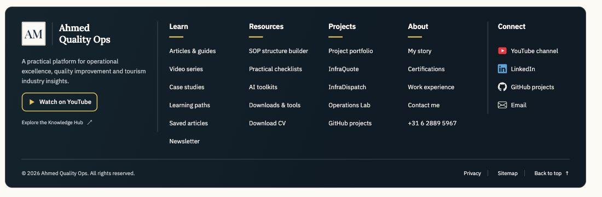

# Information-rich footer

This footer follows the supplied Design 4 screenshot: an inset rounded navy panel, a brand area separated by a fine rule, gold heading underlines, four editorial navigation columns and a separate Connect column. The desktop grid has six areas; laptop, tablet and mobile layouts reorganize the same semantic content without JavaScript.

The existing AM monogram, Lora, IBM Plex Sans, self-hosted fonts, social icon sprite and public contact details are retained. The reference's unavailable Terms and Quizzes destinations are replaced with verified Privacy/Sitemap/page navigation and learning resources. The SOP structure builder is the existing practical template destination. Newsletter links to the existing subscription page; no additional form was introduced.

## Sources and regeneration

- `templates/footer.html` is the only footer markup source.
- `assets/css/footer.css` owns the footer styles; the previous footer rules were removed from `site-chrome.css` to avoid competing components.
- `scripts/render_shared.py` includes the footer stylesheet through the existing page-bundle pipeline and adds one zero-height local back-to-top target without replacing existing body IDs.
- Run `python3 scripts/render_shared.py`, then `python3 scripts/render_shared.py --check` after source changes. All 178 rendered pages use the same template.
- Article related-reading generation now considers content links separately from the shared footer. A common footer destination must not suppress a contextual article recommendation.
- Historical image-preservation checks exclude the explicitly tested decorative footer monogram while continuing to compare original teaching images, tables, prompts and article bodies.

## Validation

- The full repository health command passed all 22 check groups, including 94 existing Python tests, JavaScript checks, pinned prompt sources, shared rendering, local links and navigation.
- Five new footer tests passed: architecture and routes, icon accessibility, shared frame and top targets, AA text contrast, and style/script ownership.
- 178 pages passed local-link checks with no missing destinations, fragments or duplicate IDs; 180 HTML pages and 4,297 TOC links passed navigation checks.
- Browser geometry checks at 1920, 1440, 1280, 1100, 768, 390 and 320px found no footer link overflow. All 31 footer links measured at least 44px high at tablet width. The mobile page remained within its viewport.
- No footer JavaScript, new font, external library or remote asset was added. The reused logo has explicit intrinsic dimensions; styles are included in existing generated CSS bundles. No Lighthouse score is claimed.
- Local health checks used Python 3.12 and Node 26. The existing GitHub workflow uses Python 3.12, Node 22 and its pinned package manager; its result remains a separate review check.

## Screenshots

The desktop proof displays the production component at a 1440px layout, scaled to 75% for a complete screenshot. Mobile and tablet proofs use the same unmodified template and CSS at their respective viewport widths. The proof server is a local review tool outside the repository.

[Mobile screenshot](mobile.png) · [Tablet screenshot](tablet.png) · [Geometry measurements](responsive-checks.json)

## Scope

This release combines the footer redesign with the previously prepared video/library enhancements, following explicit approval to merge and deploy all work. The video placement manifest and renderers preserve the 15 paragraph-level embeds, format filters, video badges, evidence notes and compact related-reading panels. Weekly availability checking is included.
